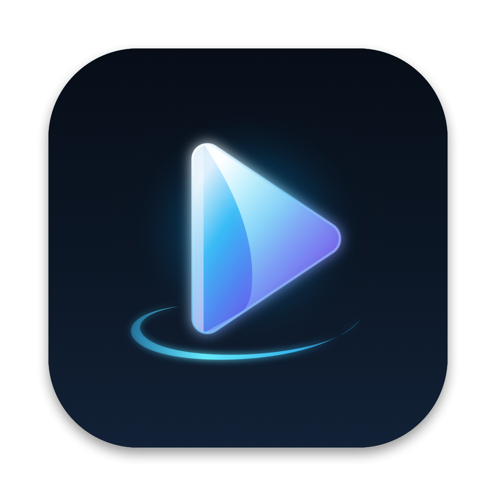

<div align="center">
  
  <h1>Velan · 微澜</h1>
  <p><strong>A fast, zero-WebView, zero-CGO native desktop media player written in pure Go.</strong></p>
  <p>
    English | <a href="README.zh-CN.md">简体中文</a>
  </p>
  <p>
    
    
    
    
    
  </p>
</div>

---

**Velan** (微澜) unifies **local videos**, **online short dramas**, **native 2x danmaku**, **IPTV live TV**, and **live streaming rooms** into a single lightweight desktop application powered by [`mygo`](https://github.com/egoist/mygo) and `libmpv` via `purego`.

## Features

- **Native Performance, Zero WebView, Zero CGO**
  - Direct OpenGL / Win32 child `HWND` video compositing with `libmpv` loaded dynamically at runtime.
  - Sub-second startup, low memory footprint, and hardware decoding (`auto-safe`).
- **Local Media & Network Streams**
  - Folder browser with sorting, keyboard navigation, and resume-from-last-position history (deduplicated per series).
  - Direct HTTP/HTTPS/HLS/MP4 stream playback (`Cmd/Ctrl + U`) and file drag-and-drop.
- **Online Short Dramas & Isolated Gateway**
  - Runs all upstream adapters inside an isolated `VelanGateway` subprocess (`127.0.0.1:0`, Bearer token auth, auto-restart supervisor).
  - Full episode recovery, 100-episode range tabs, related drama recommendations, and automatic binge-watching (auto-next episode & next recommended series).
  - Optional extra platforms toggleable in **Settings**.
- **Native 2x High-Contrast Danmaku Engine**
  - 8-direction outline + soft drop shadow for crisp readability on both bright and dark scenes.
  - Media-clock synchronized lanes, keyword filtering, local XML/ASS sidecar discovery, and live in-player styling controls (size, opacity, speed, area).
- **IPTV Live TV (M3U + XMLTV)**
  - M3U/M3U8 subscription parsing with automatic multi-line merging for duplicate channels.
  - XMLTV (`.xml` / `.xml.gz`) EPG with live programme progress bar, channel logos (`tvg-logo`), favorites pinning, 1s dwell zapping, digit channel entry, `Z` recall, and automatic failover.
- **Live Streaming Rooms (Danmaku Only, Zero Gifts)**
  - Isolated 16:9 widescreen room browser & `LiveRoomProfile` supporting Bilibili Live, Huya, and Douyu.
  - Real-time WebSocket chat danmaku (strictly plain text chat, zero gift/superchat clutter), CDN/quality switching, and in-player room switcher.

## Architecture

```
Velan (Main GUI Process: MyGo + purego libmpv)
  ├── BrowseShell  ── Home / Local / IPTV / Live / Online / Favorites / Settings
  ├── PlayerStage  ── VODSingleProfile / VODSeriesProfile / IPTVProfile / LiveRoomProfile
  └── VelanGateway ── Isolated subprocess (127.0.0.1:0 + random Bearer token + stdin EOF guard)
```

For full design details, see [docs/ARCHITECTURE.md](docs/ARCHITECTURE.md).

## Build from Source

### Prerequisites
- **Go 1.26+**
- **macOS**: `libmpv.2.dylib` (auto-discovered from `/Applications/IINA.app` or Homebrew `mpv`)
- **Windows x64**: `libmpv-2.dll` placed next to `Velan.exe`

### Run in Development
```bash
go run .
```

### Build Release Bundles
```bash
# macOS (Intel x86_64 + Apple Silicon arm64, bundles universal libmpv & Velan.icns)
bash scripts/build-macos.sh darwin/amd64,darwin/arm64

# Windows x64 (cross-compiled from macOS/Linux, bundles libmpv-2.dll into zip)
bash scripts/build-windows.sh
```

### Run Tests
```bash
go test -race ./internal/app/... ./internal/core/... ./internal/danmaku/... ./internal/gateway/... ./internal/infra/... ./internal/provider/local/... ./internal/provider/iptv/... ./internal/provider/live/...
```

## Keyboard Shortcuts

| Context | Key | Action |
| :--- | :--- | :--- |
| **Global** | `Cmd/Ctrl + O` | Open video file |
| **Global** | `Cmd/Ctrl + Shift + O` | Open folder |
| **Global** | `Cmd/Ctrl + U` | Open network URL |
| **Player** | `Space` / Click | Play / Pause |
| **Player** | `←` / `→` | Seek -5s / +5s |
| **Player** | `↑` / `↓` | Volume (VOD) / 1s dwell channel zap (IPTV) |
| **Player** | `F` / Double-click | Toggle fullscreen |
| **Player** | `D` / `M` / `S` | Toggle danmaku / Mute / Screenshot |
| **Player** | `[` / `]` / `\` | Speed -0.25x / +0.25x / Reset 1.0x |
| **Player** | `PageUp` / `PageDown` | Previous / Next episode or live room |
| **IPTV** | `0–9` / `C` / `E` / `Z` | Digit tune / Channels / EPG / Recall previous |

## License & Third-Party Notices

- Velan source code is licensed under the **MIT License** (see [LICENSE](LICENSE)).
- Bundled `libmpv` dynamic libraries follow their respective **GPL / LGPL** terms; see [THIRD_PARTY_NOTICES.md](THIRD_PARTY_NOTICES.md) for details.

## Disclaimer

Velan is a local and network media player utility. It does not host, store, or distribute any video or live-streaming content. Users are responsible for complying with the terms of service of any third-party sources and applicable local laws.
