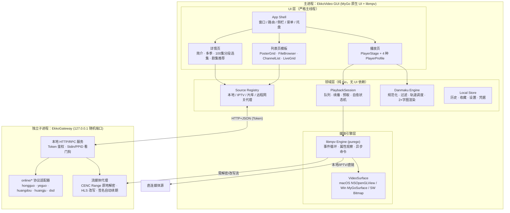

# EkkoVideo 系统架构设计

> 本文档是 `github.com/xiangkunzhang/EkkoVideo` 的唯一架构基线。所有开发与重构决策均以此为准。

---

## 1. 核心架构决策（已锁定）

| 决策项 | 锁定结论 | 说明 |
| :--- | :--- | :--- |
| **仓库与模块** | `github.com/xiangkunzhang/EkkoVideo` | 全新独立仓库，与旧 Wails 版完全解耦 |
| **UI 技术栈** | `github.com/egoist/mygo v0.10.0` 原生 UI | **零 WebView、零 HTML/JS、零 CGO**，锁定当前最新稳定版 |
| **播放引擎** | `libmpv`（通过 `ebitengine/purego` 动态加载） | 唯一视频解码与渲染引擎，所有来源统一归一为 `PlaySource` |
| **平台优先级** | **macOS 优先** → Windows → Linux | M0–M4 聚焦 macOS（Apple Silicon / Intel）打磨至生产可用，M5 补齐 Windows，M6 覆盖 Linux |
| **网关进程模型** | **独立子进程（Media Gateway）** | 在线平台协议、CENC 解密、HLS 改写与签名刷新运行在独立子进程，与主 GUI 进程故障隔离 |
| **开源许可** | 源码 **MIT** + 发行包随附 `libmpv`（GPL-2.0+/3.0） | 开源分发，详见 [THIRD_PARTY_NOTICES.md](../THIRD_PARTY_NOTICES.md) |

---

## 2. 总体分层架构



**核心分层铁律**：
1. `internal/core`、`internal/provider`、`internal/gateway` **禁止** import `github.com/egoist/mygo`，保证可脱离窗口独立单测。
2. 所有 UI 状态**只属于主线程**；网络、磁盘、解码、子进程通信一律放 goroutine，结果通过 `win.Update(func() { ... })` 回到主线程。
3. `ui.Element` 仅在当前构建帧有效，绝不存入结构体或被 goroutine 捕获；跨帧焦点与尺寸使用 `ui.Handle`。

---

## 3. 独立网关子进程设计（Media Gateway）

将易变动、易触发上游风控或需频繁解析的在线平台协议与流解密逻辑，从主 GUI 进程中剥离为独立子进程：

- **单二进制双模式**：默认启动 GUI 主进程；传入 `--gateway` 参数时进入纯无头网关子进程模式（避免打包维护两套二进制与两份签名）。
- **启动与握手**：
  1. 主进程生成 32 字节随机 `EKKO_GW_TOKEN`（经环境变量或 stdin 传递），启动子进程 `os.Executable() --gateway --port 0`。
  2. 子进程绑定 `127.0.0.1:0`，向 stdout 输出一行 JSON `{"addr":"127.0.0.1:xxxxx","pid":12345}` 后进入服务循环。
  3. 所有 API 请求校验 `Authorization: Bearer <token>` 与 `Host` 头；流代理 URL 使用随机前缀 + 一次性/会话 token。
- **防僵尸与自动拉起（Supervisor）**：
  - 子进程持续监听 `os.Stdin` EOF（管道断开即表示主进程退出/崩溃），检测到 EOF 立即优雅退出，杜绝僵尸进程。
  - 主进程监听子进程退出事件，若异常崩溃，退避重启（最多 3 次/分钟），UI 仅提示「在线源服务已自动恢复」，**正在播放的本地/IPTV 视频不受任何影响**。
- **直连优先**：本地文件、IPTV、Emby/Alist/WebDAV 直链**不经过网关**，直接把 URL 与 Header 交给 `libmpv`；仅在需要 CENC 原地解密、HLS 改写或动态续签时才经由网关代理。

---

## 4. 统一领域模型与 Provider 能力接口

### 4.1 统一条目与播放源

```go
type Kind int

const (
	KindSeries Kind = iota // 短剧 / 剧集
	KindMovie              // 电影
	KindSeason             // 季
	KindEpisode            // 单集
	KindChannel            // IPTV 频道（有 EPG）
	KindLiveRoom           // 直播间（无剧集，有聊天弹幕）
	KindFolder             // 本地 / Alist / WebDAV 目录
	KindFile               // 本地 / 网盘单个媒体文件
)

type ItemRef struct {
	Source string // Provider 实例 ID，如 "online:hongguo"、"iptv:home"、"emby:nas"、"local"
	Kind   Kind
	ID     string // Provider 内部唯一标识（本地文件为绝对路径）
}
```

所有来源最终都归一化为 `PlaySource` 交给 `libmpv`：
- `URL`、`Kind`（MP4 / HLS / DASH / FLV / RTMP / LocalFile）、`Headers`（UA/Referer/Cookie）
- `Decrypt`（非空时走网关 Range 原地解密）、`Rewrite`（HLS 改写）
- `Lines []Line`（IPTV 多线路、在线多 CDN/清晰度）、`Subtitles []SubtitleTrack`
- `StartAt`（续播点）、`ExpiresAt`（过期前自动重签）、`Live`（直播标记）、`Danmaku *DanmakuRef`

### 4.2 Provider 基础 + 可选能力接口

```go
type Provider interface {
	Info() ProviderInfo // ID、名称、图标、类型、ListStyle、能力位
}

// 按需实现，UI 与会话层通过类型断言发现能力
type Cataloger   interface { Sections(ctx) ([]Section, error); Browse(ctx, Query) (Page, error) }
type Searcher    interface { Search(ctx, q, cursor string) (Page, error) }
type Detailer    interface { Detail(ctx, ItemRef) (*Detail, error) }
type Recommender interface { Related(ctx, ItemRef) ([]Item, error) } // 同系列多季 / 剧集推荐
type Resolver    interface { Resolve(ctx, ItemRef, ResolveOpts) (*PlaySource, error) }
type Lister      interface { List(ctx, folder ItemRef, cursor string) (Page, error) }
type LiveGuide   interface { Channels(ctx) ([]Channel, error); EPG(ctx, ch ItemRef, day time.Time) ([]Programme, error) }
type DanmakuSrc  interface { Danmaku(ctx, DanmakuRef, from, to time.Duration) ([]Comment, error) }
type LiveChat    interface { Connect(ctx, DanmakuRef) (<-chan Comment, error) }
type Progresser  interface { Report(ctx, ItemRef, pos, dur time.Duration, state PlayState) error }
type Authn       interface { Login(ctx, Credentials) error; LoggedIn() bool; Logout() }
```

---

## 5. UI 结构：列表页与播放页分离设计

为了避免不同模式的业务耦合在同一个巨型页面里，采用 **「公共底座 + 按模式分文件特化」** 架构。

### 5.1 场景差异矩阵

| 场景（Scene） | 典型来源 | 列表页模板 | 详情页 | 播放页控制条 | 播放页侧栏 / 浮层 |
| :--- | :--- | :--- | :--- | :--- | :--- |
| **点播剧集 / 短剧** (`VODSeries`) | 在线短剧、Emby/fn 剧集 | `PosterGridPage`（竖版海报 + 分类/榜单） | **有**（简介、多季、100集分段选集、推荐） | 进度条、倍速、上下集、清晰度、弹幕 | 右侧可滑出抽屉：**选集** + **剧集推荐**（Tab 切换） |
| **点播单集 / 本地文件** (`VODSingle`) | 电影、本地视频、Alist/WebDAV | `PosterGridPage` / `FileBrowserPage` | 电影进详情；文件直进播放 | 进度条、倍速、音轨/字幕、画面比例、截图 | 可选抽屉：**目录播放列表** / 相似推荐（单文件隐藏） |
| **IPTV** (`IPTV`) | M3U + XMLTV | `ChannelListPage`（分组 + 台标 + 当前 EPG） | **无**（点频道直播） | **无进度条**；线路切换、刷新、音量 | 浮层：`C` **频道表**、`E` **EPG 节目单**、3s 频道 OSD |
| **直播平台** (`LiveRoom`) | 后续直播平台 | `LiveGridPage`（16:9 横版封面 + 主播/热度） | **无**（点房间直播） | **无进度条、无选集**；画质/线路/刷新/弹幕 | 可折叠并排侧栏：**实时聊天弹幕列表** + 主播信息 |

### 5.2 列表页分离（`internal/app/pages/list/`）

- `shell.go`（`BrowseShell`）：公共壳，封装顶栏拖拽、`glass.ScrollEdge` 顶部渐隐、搜索、统一 `feed` 分页/去重/首屏缓存/退避重试。
- 4 套独立模板，由 `ProviderInfo.ListStyle` 路由分派：
  - `poster_grid.go`（竖版海报墙 `ui.GridView`）
  - `file_browser.go`（面包屑 + 目录/文件自然排序列表）
  - `channel_list.go`（IPTV 分组 + 台标 + 正在播出摘要）
  - `live_grid.go`（16:9 直播间网格，预留）

### 5.3 播放页分离（`internal/app/player/`）

播放页拆分为**一套共用的 `PlayerStage`** + **按场景装配的 4 个槽位（`PlayerProfile`）**：

```go
type PlayerProfile interface {
	ID() string
	TopBar(c *ui.Context, st *PlayerViewState)
	BottomBar(c *ui.Context, st *PlayerViewState)
	SideOrOverlay(c *ui.Context, st *PlayerViewState) // 选集+推荐 / 播放列表 / EPG+频道表 / 聊天栏
	Keymap() KeymapScope                              // VOD / IPTV / LiveRoom
}
```

- `PlayerStage` 独占：视频表面渲染、`DanmakuLayer`、双击全屏/滚轮/悬停唤醒、Loading/Buffering/Error 自愈遮罩。
- `profile_vod_series.go` / `profile_vod_single.go` / `profile_iptv.go` / `profile_live.go` 各自独立维护，新增模式不改已有播放代码。

---

## 6. 媒体引擎与视频合成（macOS 优先）

### 6.1 libmpv Engine（`internal/engine/mpv/`）
- `purego` 动态加载 `libmpv.dylib`（macOS）/ `libmpv-2.dll`（Windows）。
- 统一基础参数：`config=no`、`hwdec=auto-safe`、`audio-channels=auto-safe`、`keep-open=yes`、`cache=yes`。
- 独立 goroutine 跑 `mpv_wait_event`，状态合并为不可变 `Snapshot`，以 **≤10 Hz** 节流推给 UI。
- Seek 仅在拖动释放时异步提交，保留最新目标并丢弃过期确认。

### 6.2 VideoSurface 合成策略（`internal/engine/surface/`）
- **macOS（优先验证与打磨）**：`purego/objc` 在主窗口 `contentView` 下挂载 `NSOpenGLView`（`vo=libmpv` Render API）；MyGo UI 在视频区域保持透明，控制条与弹幕直接绘制在同一个 `ui.Context` 上层（零额外透明附属窗同步问题）。虚拟机环境自动回退软件渲染位图。
- **Windows（M5 补齐）**：`wid=MyGoSurface` + `vo=gpu-next/d3d11` 硬解 + 透明附属窗控件，保留软件渲染 `ui.Bitmap.Update` 兜底方案。
- **Linux（M6）**：软件渲染 `ui.Bitmap.Update` 兜底。

### 6.3 弹幕引擎（`internal/danmaku/`）
- 时钟严格跟随 `libmpv` 播放时间（暂停即停、倍速同步、Seek 清屏续播）。
- 点播按 `[pos, pos+60s]` 分段拉取与去重；渲染采用单后台槽 `ui.Render` 生成 **2× 描边位图缓存**，动画帧仅平移贴图，限制在视频实际内容矩形内（竖屏短剧不越界）。

---

## 7. 数据存储与稳定性纪律

- **配置 / 历史 / 收藏 / 订阅**：统一使用泛型 `store[T]`（主线程投递切片快照 → 容量 1 channel 合并 → 后台 `.tmp` 原子 rename → `OnQuit` `flush`）。
- **敏感凭据**：密码与 Token 不落明文 JSON，存入系统钥匙串（macOS Keychain / Windows Credential Manager）。
- **海报与内存纪律**：`ImageLoader` 并发 ≤ 4，磁盘缓存上限 512 MiB，内存 LRU 上限 64 MiB 且 1 分钟未使用回收；**进入播放页立即清空 UI 位图缓存并取消待解码任务**。
- **容错与观测**：所有后台 goroutine 走 `safego.Go` 捕获 panic；HTTP 显式分层超时；页面离开立即 `cancel(ctx)`；设置页内置诊断信息（mpv 版本、硬/软解、丢帧、网关状态）一键复制。

---

## 8. 目录结构规划

```text
EkkoVideo/
├── main.go                     # 入口：默认启动 GUI；--gateway 启动独立网关子进程
├── mygo.json                   # 应用元数据、文件关联、更新配置
├── go.mod                      # 锁定 github.com/egoist/mygo v0.10.0
├── VERSION
├── LICENSE                     # MIT
├── THIRD_PARTY_NOTICES.md      # 第三方组件与 libmpv GPL/LGPL 声明
├── AGENTS.md                   # 开发与协作铁律
├── docs/
│   ├── ARCHITECTURE.md         # 本文档
│   └── ROADMAP.md              # M0–M6 里程碑计划
├── spike/                      # M0 技术验证（验证完成后归档或清理）
├── internal/
│   ├── app/                    # MyGo 原生 UI
│   │   ├── shell/              # 主窗口、侧栏、路由、菜单、托盘
│   │   ├── pages/
│   │   │   ├── home/           # 首页（继续观看、收藏、推荐）
│   │   │   ├── list/           # BrowseShell + 4 套列表模板
│   │   │   ├── detail/         # 剧集/电影详情页
│   │   │   └── settings/       # 设置与诊断页
│   │   ├── player/             # PlayerStage + 4 套 PlayerProfile
│   │   ├── widgets/            # 通用原生组件
│   │   └── theme/              # 主题与动效规范
│   ├── core/                   # 领域模型、Registry、PlaybackSession、Queue、Keymap
│   ├── danmaku/                # 弹幕规范化、过滤、调度与 2× 位图渲染
│   ├── engine/
│   │   ├── mpv/                # purego libmpv 绑定与事件循环
│   │   └── surface/            # VideoSurface（darwin / windows / sw）
│   ├── gateway/                # 独立网关子进程服务端、客户端与进程看门狗
│   │   ├── server/             # 127.0.0.1 HTTP 服务、Token 鉴权、CENC/HLS 代理
│   │   └── client/             # 主进程调用客户端与子进程 Supervisor
│   ├── provider/
│   │   ├── online/             # 在线平台适配器（运行在网关子进程）
│   │   ├── iptv/               # M3U / XMLTV 解析与 EPG 缓存
│   │   ├── local/              # 本地文件/目录/字幕/媒体库扫描
│   │   └── mediaserver/        # Emby / Jellyfin / fnOS / Alist / WebDAV
│   ├── infra/                  # store、imageloader、httpx、cred、log、safego、update
│   └── platform/               # 单实例、媒体键/Now Playing、防休眠
├── resources/                  # 图标、打包用 libmpv 资源
└── scripts/                    # macOS dylib 收集、签名、打包脚本
```
