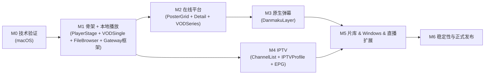

# Velan 分阶段里程碑路线图

> 策略：**接口提前定清，实现先做重点；macOS 优先打磨至稳定可用，再扩展 Windows 与 Linux。**

---

## M0：技术验证（约 1 周，macOS 优先）

**目标**：先打掉最大技术风险，确认 `MyGo v0.10.0 + purego libmpv` 同窗合成与打包链路完全跑通。

- **交付物**：`spike/` 最小可运行程序。
- **验证清单**：
  1. `purego` 动态加载 Homebrew `libmpv.dylib` 播放本地 MP4 与在线 HLS。
  2. macOS 主窗口挂载 `NSOpenGLView`（`vo=libmpv`），MyGo 原生控件与模拟弹幕直接画在视频上方；验证窗口缩放、全屏进出、深浅色切换无闪烁、无残影。
  3. 模拟 1000 条/分钟 2× 字图弹幕，测量 CPU 占用与帧率。
  4. 跑通 `go tool mygo build` + `libmpv.dylib` 及其依赖收集打包，生成可脱离 Homebrew 环境运行的 `.app`。
- **退出标准**：形成 `docs/player-macos.md` 验证结论；全部 4 项通过后进入 M1。

---

## M1：应用骨架 + 本地播放器 + 独立网关框架（约 2 周，macOS）

**目标**：先成为一个每天愿意用的 macOS 原生本地播放器，同时立好所有接口边界与独立网关子进程底座。

- **交付物**：
  - 应用壳：主窗口（`TitleBarHidden` + 侧栏磨砂 + 状态记忆）、`ui.Router`、主题、设置页、`store[T]`、日志、`safego`、单实例锁。
  - 核心接口：`core` 领域模型、`Provider` 能力接口、`BrowseShell`、`PlayerStage`、`PlayerProfile`、`Keymap`。
  - 独立网关框架：`--gateway` 子进程启动、Token 握手、stdin EOF 防僵尸、主进程异常自动拉起 Supervisor。
  - 本地播放（`VODSingleProfile` + `FileBrowserPage`）：打开文件/文件夹/URL、拖入播放、文件关联、同目录自然排序播放列表、外挂字幕自动加载、续播、完整常规快捷键（播放/快进退/音量/静音/倍速/全屏/画面比例/音轨/字幕/截图/置顶）。
- **退出标准**：
  - 日常本地看片体验流畅；
  - 强杀网关子进程后主界面与本地播放不受影响且自动恢复；
  - `go test -race ./...`、`go tool mygo vet .` 全部通过。

---

## M2：多在线平台点播（约 2 周，macOS）

**目标**：迁移并整合现有在线短剧平台能力，跑通完整「浏览 → 详情 → 连续播放」闭环。

- **交付物**：
  - 在线平台适配器全部运行在独立网关子进程内（复用现有 5 个平台协议与红果 v5 签名、CENC Range 原地解密、HLS 改写）。
  - 列表与详情：`PosterGridPage`（分类/榜单/搜索/首屏缓存）、`DetailPage`（简介、多季、100 集分段选集、相关推荐）、`ImageLoader`（磁盘/内存 LRU + 播放期清空位图）。
  - 播放体验：`VODSeriesProfile`（选集 + 剧集推荐双 Tab 抽屉）、自动连播下一集、70% 进度预取下一集、签名过期自动重签、4 类标准错误提示与诊断码。
  - 收藏与观看历史持久化。
- **退出标准**：5 个平台均可浏览、搜剧、进详情并连续播放 10 集不中断；红果加密流任意拖动进度正常。

---

## M3：原生弹幕引擎（约 1.5 周，macOS）

**目标**：实现高性能、零 WebView 的原生弹幕系统。

- **交付物**：
  - `internal/danmaku`：规范化、关键词/用户/正则/重复合并过滤、按播放时钟调度的轨道防重叠算法、单后台槽 2× 离屏字图缓存渲染。
  - 点播分段按需拉取（`[pos, pos+60s]`），支持暂停、倍速、Seek 同步清屏，竖屏视频限制在画面矩形内。
  - 支持本地 B 站 XML / ASS 弹幕文件加载与设置面板（开关/字号/透明度/速度/区域/描边）。
- **退出标准**：高密度弹幕下视频不掉帧；竖屏/横屏切换弹幕边界准确。

---

## M4：IPTV 电视直播（约 1.5 周，macOS，可与 M3 并行）

**目标**：具备完整好用的桌面电视体验。

- **交付物**：
  - M3U/M3U8 订阅管理（支持多订阅、同名频道自动合并多线路）。
  - XMLTV 节目单（支持 `.gz`、按天磁盘缓存、`x-tvg-url` 自动发现）。
  - `ChannelListPage`（分组 + 台标 + 正在播出摘要）与 `IPTVProfile`（`↑/↓` 1s dwell 换台、数字键选台、`Z` 回看上一台、`C` 频道表浮层、`E` EPG 浮层、3s 频道 OSD）。
  - 起播超时/卡顿自动切换下一条线路，并记忆频道可用线路。
- **退出标准**：导入公开 M3U 换台顺畅；坏线路 15s 内自动切换；EPG 准确显示当前与下一档节目。

---

## M5：片库管理 + Windows 原生适配 + 直播扩展（约 3–4 周）

**目标**：扩展自建片库生态，并完成 Windows x64 完整适配。

- **交付物**：
  - 片库 Provider（按顺序落地）：Emby / Jellyfin → 飞牛影视（fnOS）→ Alist / OpenList → WebDAV；支持播放进度双向回传、钥匙串凭据存储、按「服务器+账号」隔离缓存。
  - 本地媒体库扫描与可选弹弹play 弹幕匹配。
  - Windows x64 适配：`libmpv-2.dll` + `MyGoSurface` 硬解与透明控件覆盖层（或 SW 位图兜底）、Windows Credential Manager、安装包构建脚本。
  - 直播平台扩展（按需）：基于已预留的 `LiveGridPage` + `LiveRoomProfile` + `LiveChat` 接入直播间。
- **退出标准**：Emby/飞牛进度双向同步准确；macOS 与 Windows 双端均能打包运行。

---

## M6：稳定性、系统生态与正式发布（约 1.5 周）

**目标**：达到长期日常使用与公开发布标准。

- **交付物**：
  - `mygo.Updater` 自动更新与签名校验。
  - 系统集成：macOS Now Playing / Windows SMTC 媒体键、播放防休眠、可选菜单栏托盘常驻。
  - 诊断页与一键导出诊断包、日志轮转。
  - Linux 软件渲染版适配。
  - 压测与回归：连续播放 4 小时内存无持续增长、冷启动 < 1.5s 显示缓存首页、CI 自动构建与 Release 打包。
